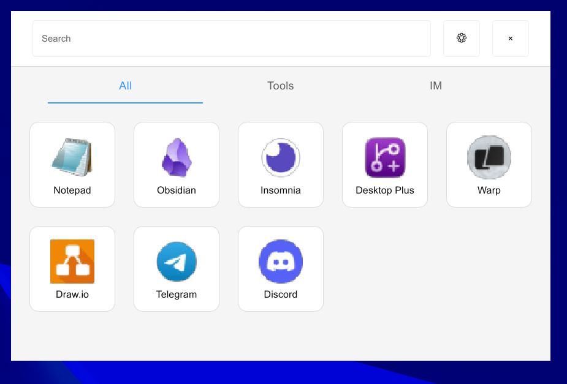

# Open WinApp Launch

<p align="center">
  
  
</p>


A lightweight and fast Windows 11 app launcher that stays in the system tray and opens a searchable app grid with **Ctrl+Alt+E** key shortcut. App definitions are stored in `%APPDATA%\AppLauncher\config.yaml` and reloaded when the file changes.  
The installer is per-user and does not request administrator access.  

> This app is inspired by the old [Appetizer Launcher](https://appetizer.cozic.net/) with minimalistic UI similar to the [Win App Launcher](https://apps.microsoft.com/detail/9n4hkq11v72w?hl=en-US&gl=US). 

<p align="center">

</p>

## Download
After the repository is published, download the installer or portable ZIP from its **Releases > Assets** page.   
Binaries are unsigned; Windows may show an
unknown-publisher warning. Do not disable Windows security features globally.

## Guides
- [First repository setup, branch protections, and releases](docs/RELEASING.md)
- [Contributing and development checks](CONTRIBUTING.md)
- [Notes on how to develop and build the application](docs/DEVELOP.md)
- [Notes on security](SECURITY.md)
- [GPL-3.0 license](LICENSE) and [third-party distribution notes](THIRD_PARTY.md)

## Configure apps

The default nested format preserves YAML group and app order:

```yaml
settings:
  hotkey: "Ctrl+Alt+E"
groups:
  - name: Dev
    apps:
      - name: Visual Studio Code
        path: 'C:\Program Files\Microsoft VS Code\Code.exe'
        args: ['--new-window']
        workdir: 'C:\Projects'
        icon: 'C:\Icons\vscode.png'
  - name: Tools
    apps:
      - name: Notepad
        path: 'C:\Windows\notepad.exe'
```

- `args`, `workdir`, and `icon` are optional. 
- `icon` can point to an image or executable/library; when omitted, the launcher uses the app executable's Windows shell icon. Paths support `%ENVIRONMENT_VARIABLE%` expansion, then must be fully qualified drive-letter paths. 
- Executables must end in `.exe`; bare names such as `calc.exe`, relative paths, scripts, UNC/device paths, and alternate data streams are rejected. Network executables and working directories are rejected at launch, including resolved UNC paths and mapped network drives. Arguments are separate literal strings, not a shell command line.
- Use either `groups:` or top-level `apps:`, not both. 
- The configuration is limited to 1 MiB and rejects unknown fields. 
- If a changed file contains invalid YAML or settings, the app shows an error and keeps the last valid configuration.

A flat app list is also supported. Groups are created in first-seen order; apps without a `group` are placed in `Other`:

```yaml
apps:
  - name: Visual Studio Code
    path: 'C:\Program Files\Microsoft VS Code\Code.exe'
    group: Dev
  - name: Notepad
    path: 'C:\Windows\notepad.exe'
    group: Tools
```